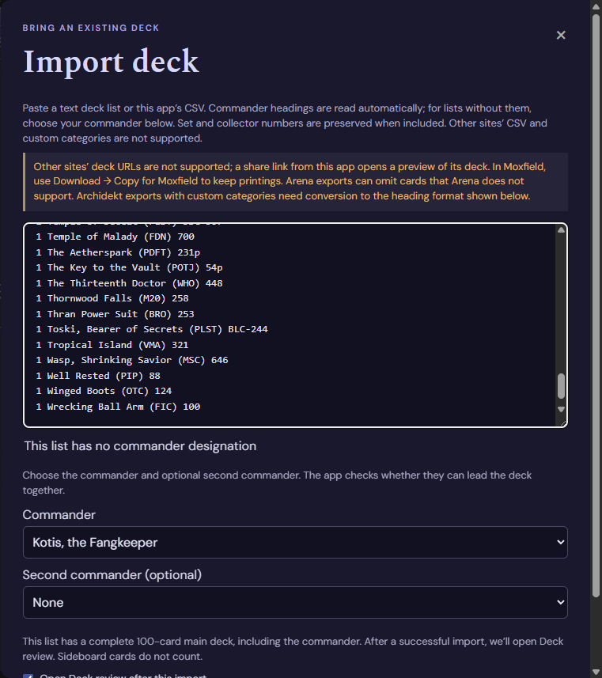
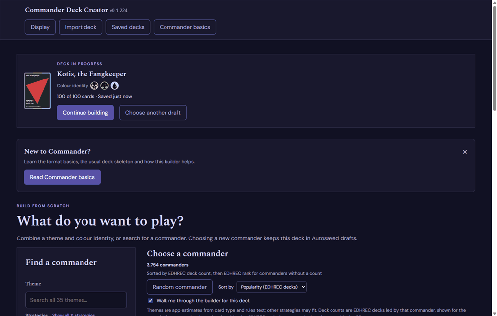
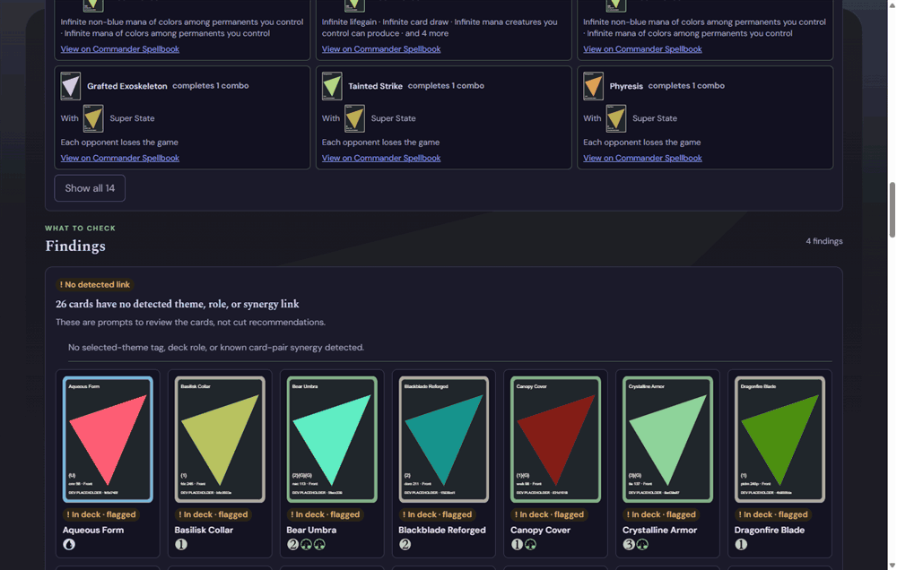

# Benchmark audit: rebuilding a Kotis Voltron deck ([#607](https://github.com/tomcorke/mtg-commander-deck-creator/issues/607))

Run 2026-11-15 on app v0.1.224 (`main` at `482a60c`). The benchmark is a real, hand-built Commander deck. This audit records what the app's analysis says about it, rebuilds it from scratch the way a player would, compares the two and triages what went wrong. It changes no app code; every actionable finding is filed as its own issue.

## Method

- **Source deck.** [Kotis the Exiler](https://moxfield.com/decks/fDhOKV0cxkKIeYJx8HiPfg), a public Moxfield deck led by Kotis, the Fangkeeper (blue-black-green). One `curl` request to Moxfield's v3 deck endpoint with Chrome's user agent returned HTTP 200 JSON. This follows the knowledge base's [Moxfield deck-list note](../../mtg-knowledge-base/knowledge/topics/providers/moxfield-deck-lists.md), which records that request shape as a working example, not an API contract. The response held 99 mainboard cards plus 1 commander, with no other boards, last updated 2026-11-14.
- **Import path.** The app has no URL import, so the JSON was turned into the layout of Moxfield's "Copy for Moxfield" export (`1 Name (SET) number`, commander first, `*F*` for foils) and pasted into **Import deck**. That layout is described in [deck format compatibility](deck-format-compatibility.md). The native export menu itself was not used.
- **App.** `pnpm dev:record` on port 5297, driven with Playwright through the Chrome DevTools Protocol (headless Chrome 157, 1440×1000, dark theme). Scryfall responses were recorded live. EDHREC was recorded live under the [live EDHREC policy](domain/data-sources.md#live-edhrec-recordings), opt-in with `DEV_REPLAY_EDHREC=live`, into a cache outside the checkout. Card art is the replay's generated placeholder, so screenshots show triangles rather than card scans.
- **Analysis cross-check.** The app's own `rolesForCard`, `cardFeatures` and `detectLandRoles` were run over the recorded Scryfall records of all 100 cards, giving the per-card role list behind each Deck review count.
- **Rebuild rule.** As a stand-in for the deck's author: pick Kotis, choose the Casual play style (Core, Theme first), choose Voltron, and **Add** every offered card that is in the source deck and **Later** everything else. After 12 batches, use **Build a starting deck**, then inspect **Choose lands** and compare a Balanced draft.

EDHREC run log:

| Date (UTC) | Mode       | EDHREC pages | Stop reason |
| ---------- | ---------- | ------------ | ----------- |
| 2026-11-15 | dev:record | 24/50        | interrupted |

The server was force-stopped, which skips its own log line; the row comes from `/__dev-replay/status` read just before the stop (`edhrecPages: 24`, `edhrecStopped: null`). Nineteen pages were Start's colour-identity popularity lists; the others were the Kotis page and four card pages. Responses stay in the local cache only.

Provider data quoted below: EDHREC, `https://json.edhrec.com/pages/commanders/kotis-the-fangkeeper.json`, fetched 2026-11-15, 20,821 decks. Inclusion is `num_decks / potential_decks`, rounded. EDHREC figures describe submitted decklists, not card quality ([card data limits](../../mtg-knowledge-base/knowledge/topics/providers/card-data.md)).

## 1. Source deck analysis

Kotis, the Fangkeeper is indestructible. Whenever it deals combat damage to a player, it exiles that many cards from the top of their library, and its controller may cast spells from among them with mana value up to that damage without paying their costs (Scryfall Oracle text, provider data). The deck is a Voltron build: 27 Equipment and 17 Auras to make Kotis hit hard and evasively, a low curve, eight mana accelerants, and creatures that pay off combat damage to players (Toski, Gonti, Grim Hireling, Felix Five-Boots). It runs 35 lands: 16 nonbasic plus 11 Forest, 4 Island and 4 Swamp. Scryfall marks none of its cards as a Game Changer, and Moxfield's JSON reports `bracket: 2`. That bracket is Moxfield's own field, not an app or Wizards verdict ([format policy](../../mtg-knowledge-base/knowledge/topics/commander/format-policy.md)).

The import parsed all 100 cards and asked for the commander, as documented for lists with no commander heading. **Import and review** then left the player on Start instead of opening Deck review (F3).

What the app reports for the imported deck ([builder](evidence/607/03-source-builder.png), [review with Voltron](evidence/607/05-source-review-voltron.png)):

| Area                  | App reading                                                                                                                  | Assessment                                                                                                                                                                                                                                                                  |
| --------------------- | ---------------------------------------------------------------------------------------------------------------------------- | --------------------------------------------------------------------------------------------------------------------------------------------------------------------------------------------------------------------------------------------------------------------------- |
| Size                  | 100/100, commander included; 0 sideboard                                                                                     | Correct ([Commander rules](../../mtg-knowledge-base/knowledge/topics/commander/rules.md), 903.5a, 903.5e).                                                                                                                                                                  |
| Curve                 | 65 nonland spells, average mana value 2.7, 6 at 5+                                                                           | Correct, and it reflects the plan: Kotis casts free spells up to the damage dealt.                                                                                                                                                                                          |
| Colour                | Cost symbols U 18, B 12, G 27; sources U 16, B 17, G 25, C 2; no unsourced symbols                                           | Plausible.                                                                                                                                                                                                                                                                  |
| Lands                 | 35/38 "3 below target"; guidance range 36–38; land-drop context "about even" by turn 4                                       | Heuristic ([heuristics](domain/heuristics.md), [#587](https://github.com/tomcorke/mtg-commander-deck-creator/issues/587)). The deck deliberately runs 35 with 8 accelerants. Known limit, owned by [#98](https://github.com/tomcorke/mtg-commander-deck-creator/issues/98). |
| Ramp                  | 8/10: Birds, Bloom Tender, Llanowar Elves, Fellwar Stone, Herd Heirloom, Rampant Growth, Sword of the Animist, Janice Rand   | Matches the [#592](https://github.com/tomcorke/mtg-commander-deck-creator/issues/592) rule. Sword of Forge and Frontier's extra land play and the Treasure from Grim Hireling, Sword of Wealth and Power and Dragon-Cursed Halls are excluded by design.                    |
| Card draw             | 16/10                                                                                                                        | Inflated by Foreboding Landscape's cycling and Invasion of Fiora's back face (F9).                                                                                                                                                                                          |
| Targeted removal      | 8/8                                                                                                                          | Plausible.                                                                                                                                                                                                                                                                  |
| Board wipes           | 2/3: Blood Money, Invasion of Fiora                                                                                          | Correct; Invasion of Fiora's front face destroys all legendary and/or all nonlegendary creatures.                                                                                                                                                                           |
| Types                 | Land 35, Creature 14, Artifact 29, Enchantment 18, Instant 2, Sorcery 2, Planeswalker 1, Battle 1                            | Creature reads 14 but highlights 15, and the board lists the battle under Creatures (F10).                                                                                                                                                                                  |
| Themes                | Suggested theme Voltron, 47 cards; also detected Artifacts 37, Combat 35, Equipment 28, Enchantments 21                      | Good: Voltron is the deck's plan.                                                                                                                                                                                                                                           |
| Combos                | None complete; 14 one away, such as Grafted Exoskeleton, Tainted Strike or Phyresis with Super State ("each opponent loses") | Provider data from Commander Spellbook; reasonable.                                                                                                                                                                                                                         |
| Play signals          | Mass land denial, extra turns, two-card combos and win-the-game text all 0                                                   | Correct for this list.                                                                                                                                                                                                                                                      |
| Price                 | $495.22, 2 cards unpriced (TCGplayer via Scryfall)                                                                           | Provider data.                                                                                                                                                                                                                                                              |
| Findings, as imported | 4: No detected link (26 cards), lands short, ramp short, wipes short                                                         | The 26 "unlinked" cards are Voltron pieces, and the suggested swaps cut them (F4).                                                                                                                                                                                          |
| Findings, Voltron     | 3: lands, ramp, wipes                                                                                                        | Suggested swaps now cut Felix Five-Boots, Toski, Gonti, Enduring Curiosity and Wasp, the cards that pay off Kotis's trigger (F5).                                                                                                                                           |

What the analysis misses about this deck: it has no idea that Kotis wants combat damage to players, so commander payoffs read as unlinked, and it counts Kotis's evasion and protection only as generic Voltron text.

## 2. Rebuild log

| Step | Action                                                                     | Result and friction                                                                                                                                                                                                                                                                      | Evidence                                                                                             |
| ---- | -------------------------------------------------------------------------- | ---------------------------------------------------------------------------------------------------------------------------------------------------------------------------------------------------------------------------------------------------------------------------------------- | ---------------------------------------------------------------------------------------------------- |
| 1    | **Start over**, confirm, search "Kotis"                                    | Two results. Kotis's tile themes read Indestructible, Zombies, Combat; Voltron, the deck's real plan, is not inferred from the commander's text. Known limit of commander theme estimates.                                                                                               | [06](evidence/607/06-rebuild-commander-search.png)                                                   |
| 2    | **Choose** Kotis                                                           | Builder opens on "How do you want to play?"                                                                                                                                                                                                                                              | [07](evidence/607/07-rebuild-play-style.png)                                                         |
| 3    | Choose **Casual** (Core, Theme first)                                      | The five-step intro guide opens over the builder. It never mentions choosing a theme or Build a starting deck. The first batch, with no theme yet, is four ramp/land picks.                                                                                                              | [15](evidence/607/15-rebuild-intro-guide.png)                                                        |
| 4    | **+ Choose theme**, Voltron                                                | Voltron is the first option. The current batch stays four "Generic pick" cards, as decided in [#153](https://github.com/tomcorke/mtg-commander-deck-creator/issues/153), and the Next button reads "rebuilding for Voltron & Voltron" (F11).                                             | [08](evidence/607/08-rebuild-choose-theme.png), [09](evidence/607/09-rebuild-batch1-after-theme.png) |
| 5    | Batches 2–13 (48 offers)                                                   | 27 offers were source-deck cards; 26 were added (one Add click on Security Bypass timed out in the harness, not confirmed as an app fault). Others offered: licids, Leyline Axe, Brotherhood Regalia, Boseiju, Rogue's Passage. None of Kotis's ten EDHREC Top Cards ever appeared (F1). | [10](evidence/607/10-rebuild-batch2.png), [11](evidence/607/11-rebuild-batch10.png)                  |
| 6    | **Choose lands** at 27 cards (inspected, then cancelled)                   | Plans 8 nonbasics led by Demolition Field, Abstergo Entertainment and Cactus Preserve; Opulent Palace and Hinterland Harbor are "A basic does as well" (F6). Basics split 21 Forest, 1 Island, 1 Swamp (F7). Copy reads "basic-land searchs" (F11).                                      | [13](evidence/607/13-rebuild-choose-lands.png)                                                       |
| 7    | **Build a starting deck** (Theme first)                                    | Adds 73 cards (50 spells and nonbasics, 23 basics) and opens Deck review: 5 of 5 role targets met, 0 findings. Twelve drafted nonland cards are not on Kotis's EDHREC page (F2). Basics use an unreleased printing; export shows 33 unpriced cards (F8).                                 | [12](evidence/607/12-rebuild-starting-deck-theme-first.png)                                          |
| 8    | **Undo starting deck**; Priority **Balanced**; Build a starting deck again | Ramp 20/10 and Card draw 20/10 (F12); Sol Ring and Arcane Signet now included; still none of the ten Top Cards; 40 unpriced.                                                                                                                                                             | [14](evidence/607/14-rebuild-starting-deck-balanced.png)                                             |
| 9    | Undo; **Next recommendations** under Balanced; Build a starting deck again | Same pattern: Ramp 20/10, Card draw 20/10, no Top Cards, basics 19 Forest, 3 Island, 1 Swamp.                                                                                                                                                                                            | Recorded in the run notes                                                                            |

Every path reached exactly 100 cards. Light theme and narrow viewports were not checked; this audit concerns recommendations and analysis, not layout.

## 3. Comparison

Counts exclude the commander and basics. The source has 80 such cards.

|                                       | Source (hand-built) | Theme first draft       | Balanced draft        | Balanced, fresh batch |
| ------------------------------------- | ------------------- | ----------------------- | --------------------- | --------------------- |
| Source cards kept                     | 80/80               | 44/80 (26 from batches) | 40/80                 | 38/80                 |
| Lands / ramp / draw / removal / wipes | 35 / 8 / 16 / 8 / 2 | 38 / 10 / 13 / 9 / 3    | 38 / 20 / 20 / 11 / 3 | 38 / 20 / 20 / 11 / 3 |
| Basics (Forest / Island / Swamp)      | 11 / 4 / 4          | 16 / 1 / 6              | 20 / 2 / 1            | 19 / 3 / 1            |
| Average mana value                    | 2.7                 | 2.5                     | not recorded          | not recorded          |
| Voltron matches                       | 47                  | 48                      | not recorded          | not recorded          |
| Deck review findings                  | 4 (3 with Voltron)  | 0                       | 0                     | 0                     |
| Price (TCGplayer via Scryfall)        | $495.22, 2 unpriced | $397.07, 33 unpriced    | $359.92, 40 unpriced  | not recorded          |

**Cards the app never surfaced.** Of the 36 source cards the Theme first rebuild missed, the most-played on Kotis's EDHREC page are Swiftfoot Boots, Rancor and Aqueous Form (67% each), Dragonfire Blade (57%), Favor of the Overbeing (56%), Felix Five-Boots (54%), Rampant Growth (51%) and Blackblade Reforged (50%). Every one sits in the EDHREC "Top Cards" list; the saved queue held them as "Commander favourite" at positions 104–151 of 1,299 (F1). The rest are mostly low-inclusion picks the author chose on purpose (Sword of Truth and Justice 6%, Super State 8%, Nettlecyst 6%), or cards not on the page at all (Wasp, Shrinking Savior; Grim Hireling; Invasion of Fiora). Their absence is expected from a popularity-led recommender.

**Cards ranked too high.** The Theme first draft added Wall of Putrid Flesh, Leeching Licid, Nyxborn Eidolon, Erebos's Emissary, Gnarled Scarhide, Baleful Eidolon, Hateful Eidolon and five more cards absent from Kotis's EDHREC page. They are local-index matches with no evidence score and no price (F2). Its lands added Demolition Field, Abstergo Entertainment, Cactus Preserve and Restless Cottage, while Opulent Palace (57%), Hinterland Harbor (53%) and Woodland Cemetery (49%) were left out (F6).

**Role and land gaps.** The drafts meet every role target, but the Balanced drafts reach that by doubling ramp and draw (F12). Every draft piles basics into Forest (F7). All three drafts play 38 lands to the source's 35; that is the [#587](https://github.com/tomcorke/mtg-commander-deck-creator/issues/587) baseline working as designed.

**Theme drift.** The drafts keep Voltron counts high (48 against 47), but much of the theme count is filler that only matches the "enchanted creature" text. The commander-specific engine is thin: Felix Five-Boots and Grim Hireling are in no draft, Toski is missing from the Theme first draft and Gonti from both Balanced drafts. Deck review still reports "On target" with no findings, so a player gets no signal that a draft is weaker than the source.

## 4. Triaged findings

Severity: **high** steers the recommended deck away from the commander's core cards; **medium** gives a wrong or misleading result a player would act on; **low** is cosmetic or narrow.

| ID  | Category            | Severity | Finding                                                                                                                 | Evidence                                                                                                   | Issue                                                                     |
| --- | ------------------- | -------- | ----------------------------------------------------------------------------------------------------------------------- | ---------------------------------------------------------------------------------------------------------- | ------------------------------------------------------------------------- |
| F1  | Recommendation gap  | High     | The commander's ten EDHREC Top Cards (50–67%) are never offered in 12 batches or drafted under Theme first or Balanced. | Step 5 and steps 7–9; queue positions 104–151; Theme first's −15 penalty in `recommendationScoreBreakdown` | [#618](https://github.com/tomcorke/mtg-commander-deck-creator/issues/618) |
| F2  | Recommendation gap  | High     | The starting deck fills theme slots with evidence-free local matches such as licids and bestow creatures.               | Step 7; 12 nonland picks not on Kotis's EDHREC page; `Local card match`, no price                          | [#619](https://github.com/tomcorke/mtg-commander-deck-creator/issues/619) |
| F3  | Analysis bug (flow) | Medium   | **Import and review** from Start imports the deck but returns to Start.                                                 | Section 1, screenshot 02; route `#start/import` → `#start`                                                 | [#620](https://github.com/tomcorke/mtg-commander-deck-creator/issues/620) |
| F4  | Analysis bug        | Medium   | After import, Deck review flags 26 cards of the detected Voltron theme as unlinked and suggests cutting them.           | Screenshot 04; swaps cut Super State, Blackblade Reforged, Hunter's Axe                                    | [#621](https://github.com/tomcorke/mtg-commander-deck-creator/issues/621) |
| F5  | Missed opportunity  | Medium   | Suggested cuts include cards that pay off the commander's own trigger (Felix Five-Boots, Toski, Gonti).                 | Screenshot 05; Kotis and Felix Oracle text                                                                 | [#622](https://github.com/tomcorke/mtg-commander-deck-creator/issues/622) |
| F6  | Recommendation gap  | Medium   | The land plan ranks costed, conditional or copy-only any-colour lands above on-colour duals and the Sultai tri-land.    | Step 6, screenshot 13; Opulent Palace 57% marked "A basic does as well"                                    | [#623](https://github.com/tomcorke/mtg-commander-deck-creator/issues/623) |
| F7  | Recommendation gap  | Medium   | The basic split puts almost every basic into one colour (21 / 1 / 1 at 27 cards).                                       | Steps 6–9; comparison table                                                                                | [#624](https://github.com/tomcorke/mtg-commander-deck-creator/issues/624) |
| F8  | Analysis bug        | Medium   | Basics default to an unreleased, unpriced printing (MDD, released 2027-04-09) despite "Exclude unreleased cards".       | Step 7; 33 and 40 unpriced; Scryfall `cards/named?exact=Forest`                                            | [#625](https://github.com/tomcorke/mtg-commander-deck-creator/issues/625) |
| F9  | Analysis bug        | Low      | Card draw counts cycling lands and a battle's back face, against the documented heuristic.                              | Section 1 (draw 16/10); Foreboding Landscape, Zagoth Triome, Invasion of Fiora                             | [#626](https://github.com/tomcorke/mtg-commander-deck-creator/issues/626) |
| F10 | Analysis bug        | Low      | Type counts disagree with the cards they highlight (Creature 14 vs "Show 15"); the battle is grouped under Creatures.   | Section 1; `typeCounts` vs `typeStats`                                                                     | [#627](https://github.com/tomcorke/mtg-commander-deck-creator/issues/627) |
| F11 | UX friction         | Low      | Copy errors: "rebuilding for Voltron & Voltron"; "basic-land searchs".                                                  | Steps 4 and 6                                                                                              | [#628](https://github.com/tomcorke/mtg-commander-deck-creator/issues/628) |
| F12 | Recommendation gap  | Medium   | The Balanced starting deck doubles the ramp and draw targets (20/10 each) while leaving theme staples out.              | Steps 8–9                                                                                                  | [#629](https://github.com/tomcorke/mtg-commander-deck-creator/issues/629) |

### Known heuristic limits and existing decisions

These need no new issue:

- **35 lands flagged as 3 short of 38.** The 38-land baseline and 36–38 guidance are uncalibrated heuristics from [#587](https://github.com/tomcorke/mtg-commander-deck-creator/issues/587). The [land-count evidence](../../mtg-knowledge-base/knowledge/topics/deckbuilding/commander-land-counts.md) records a median of 36 lands on EDHREC. Calibration belongs to [#98](https://github.com/tomcorke/mtg-commander-deck-creator/issues/98).
- **Extra land plays and Treasure on combat damage are not ramp.** Sword of Forge and Frontier, Sword of Wealth and Power, Grim Hireling and Dragon-Cursed Halls fall outside the [#592](https://github.com/tomcorke/mtg-commander-deck-creator/issues/592) rule by design ([heuristics](domain/heuristics.md#ramp-counting-592)).
- **The current batch does not refresh when a theme is chosen.** Decided in [#153](https://github.com/tomcorke/mtg-commander-deck-creator/issues/153); the button's rebuild note says so.
- **Commander tiles infer themes from the commander's own text** (Indestructible, Zombies, Combat for Kotis), so Voltron is not shown on Start. This is documented in [heuristics](domain/heuristics.md#themes-and-pair-clues).
- **Land-role and Choose lands follow-ups:** [#596](https://github.com/tomcorke/mtg-commander-deck-creator/issues/596) (scaling-mana lands) and [#608](https://github.com/tomcorke/mtg-commander-deck-creator/issues/608) (basic rows and `CardReference`) are open. [#602](https://github.com/tomcorke/mtg-commander-deck-creator/issues/602) (land-role quote strings) and [#603](https://github.com/tomcorke/mtg-commander-deck-creator/issues/603) (basic edits reset when the plan changes) were fixed after this run. This audit did not reproduce any of them separately.
- **Placeholder art.** Rendered art, crop and foil checks need plain `pnpm dev`; they were out of scope.

### Unconfirmed observations

- One **Add** click on Security Bypass in batch 6 and one **Later** on Demonic Embrace in batch 11 timed out in the Playwright harness. The screenshot shows the offer rendered normally; the failure was not reproduced by hand, so it is not filed.
- The saved queue held Felix Five-Boots as OTC 6 with finish `foil` although a nonfoil OTC 42 printing exists. [#497](https://github.com/tomcorke/mtg-commander-deck-creator/issues/497) fixed foil defaults for cheaper nonfoils; this case was not checked in the UI.

## Knowledge-base follow-ups

These provider facts surfaced here; the knowledge base was not edited.

1. **Moxfield v3 endpoint, rechecked 2026-11-15.** `GET https://api2.moxfield.com/v3/decks/all/fDhOKV0cxkKIeYJx8HiPfg` with Chrome 157's user agent and `Accept: application/json` returned HTTP 200 JSON (411,189 bytes). The response carried `bracket` and `autoBracket` (both 2). Its card records had no Game Changer field. This extends the 2026-10-21 observation in `knowledge/topics/providers/moxfield-deck-lists.md` to a second public deck.
2. **Scryfall default printing can be unreleased.** On 2026-11-15, `cards/named?exact=Forest` returned the MDD printing with `released_at` 2027-04-09 and `prices.usd` null. Belongs in `knowledge/topics/providers/card-data.md`.

Raw responses, role dumps and full-size screenshots stay outside Git in the local research folder.
