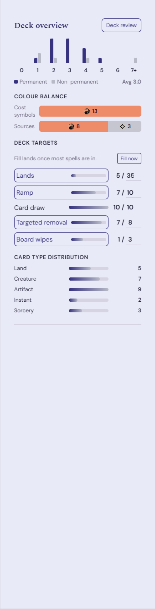
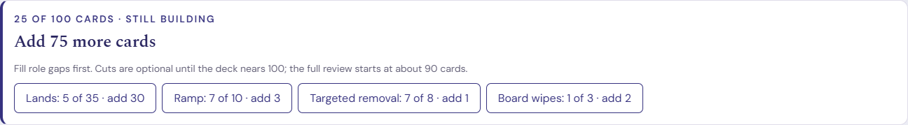
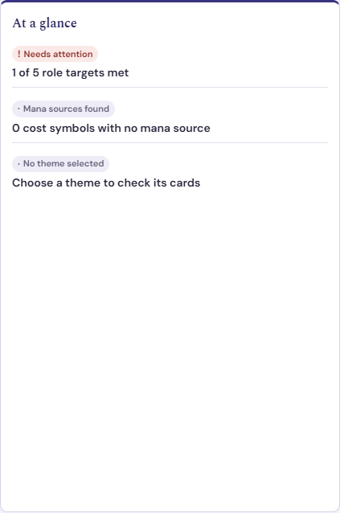
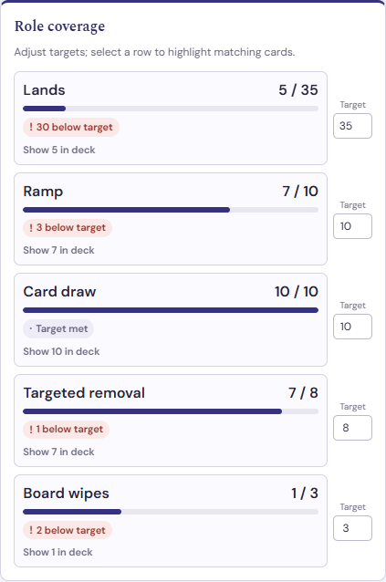

# Where deck figures repeat

Issue #31. This survey lists every place the app shows role targets, land counts, the mana-value curve and colour balance, then proposes options. It changes no UI; pick an option before any UI work starts.

Screenshots come from a 25-card Krenko, Mob Boss draft in light mode at 1440px, taken on `main` at `cdc8e11`.

## The two screens

The builder sidebar and Deck review are separate full-page views. They never appear together, so a player sees at most one of them at a time. The repetition the issue describes is inside Deck review: before the deck reaches 90 cards, the same role figures appear in three or four places on one page.

### Builder sidebar ("Deck overview")

From top to bottom:

| Figure         | Shown as                                                                                                                                   | Purpose                                     |
| -------------- | ------------------------------------------------------------------------------------------------------------------------------------------ | ------------------------------------------- |
| Curve          | Bar chart with average; bars filter the deck list                                                                                          | Glanceable shape while picking cards        |
| Colour balance | Two stacked bars: cost symbols and sources per colour                                                                                      | Quick check that sources keep up with costs |
| Land guidance  | "This curve suggests X–Y lands" with Use N (only when the target is outside the range); "Fill lands once most spells are in" with Fill now | Decide the land target and fill basics      |
| Role targets   | Five rows: count / editable target; rows below target focus recommendations on that role                                                   | Steer the next recommendation batch         |
| Card types     | Count per type                                                                                                                             | Context only                                |

Each figure appears once here. Every one has a job tied to picking the next cards.

### Deck review, build mode (under 90 cards)

| #   | Place                         | Figures                                                                                      | Purpose                                      |
| --- | ----------------------------- | -------------------------------------------------------------------------------------------- | -------------------------------------------- |
| 1   | "Add N more cards" panel      | One chip per role below target: "Lands: 5 of 35 · add 30"                                    | Jump to Choose changes filtered to that role |
| 2   | At a glance                   | "1 of 5 role targets met"; "0 cost symbols with no mana source"                              | One-line verdicts                            |
| 3   | Role coverage                 | Five rows: count / target, progress bar, "N below target", editable target, "Show N in deck" | Edit targets; highlight matching cards       |
| 4   | Mana-value curve              | Same chart as the sidebar, plus nonland count, average and "N cost 5 or more"                | Highlight cards by mana value                |
| 5   | Mana costs                    | Per colour: symbols, source cards, status                                                    | Highlight cards by colour demand             |
| 6   | Card-type distribution        | Count per type, including Land                                                               | Highlight cards by type                      |
| 7   | Findings, suggested additions | "Lands 5 → 6 · Curve: +1 at land" per suggestion                                             | Show what one addition changes               |

Later steps add two more:

| #   | Place                                 | Figures                            | Purpose                    |
| --- | ------------------------------------- | ---------------------------------- | -------------------------- |
| 8   | Choose changes, "Show candidates for" | "Lands (30 below target)" per role | Filter candidates          |
| 9   | Choose changes, "After these changes" | "Lands: 5 → 6" per role            | Preview the selected swaps |

## Where it actually repeats

On the Diagnose step, role targets appear three times within one scroll: the chips (1), the At a glance count (2) and Role coverage (3). Lands appear a fourth time in card-type distribution (6). That row filters the deck list by the Lands role, but its count is a type count, so the two numbers can disagree for cards such as modal double-faced lands.

The chips and Role coverage show the same numbers in different words ("5 of 35 · add 30" against "5 / 35 · 30 below target"), and they do different things when clicked: the chips go to Choose changes, while Role coverage highlights cards in the deck list.

Colour balance appears twice (2 and 5), but as a one-line verdict and a breakdown, which reads as summary and detail rather than a repeat.

The curve appears once per screen.

Rows 7 to 9 show changes (before → after) rather than totals, so they don't repeat the totals.

## Options

### A. One source per screen

Remove the chips (1) and the role line in At a glance (2). Role coverage becomes the only place role totals appear on Diagnose. Add a "Find cards" action to each Role coverage row below target, so the chips' jump to Choose changes isn't lost.

- Removes two of the three repeats.
- Role coverage sits further down the page, so the first thing a player sees on a small deck is no longer the role gaps.

### B. Linked summary

Keep the chips as the summary and make them the only role figures above the fold. Remove the role line from At a glance. Each chip links to its Role coverage row (scroll and focus) as well as to Choose changes, or the chip text shrinks to "Lands · add 30".

- Keeps the gaps visible first on a small deck.
- Two places still show role numbers, but one is plainly a summary of the other.

### C. Keep the repetition

Leave the layout as it is and align the wording, so "5 of 35 · add 30" and "5 / 35 · 30 below target" read as one figure in two places. Make the card-type Land count and the Lands role agree, or label them so the difference is clear.

- Smallest change.
- The page still repeats the same figures within one scroll.

## Recommendation

B. Before 90 cards, the chips are the most useful element on Deck review, since they answer "what should I add next?". The At a glance role line adds nothing next to them. Option C's Land count fix is worth doing whichever option is picked.

Nothing should change in the builder sidebar. It shows each figure once, and it is never on screen at the same time as Deck review.
